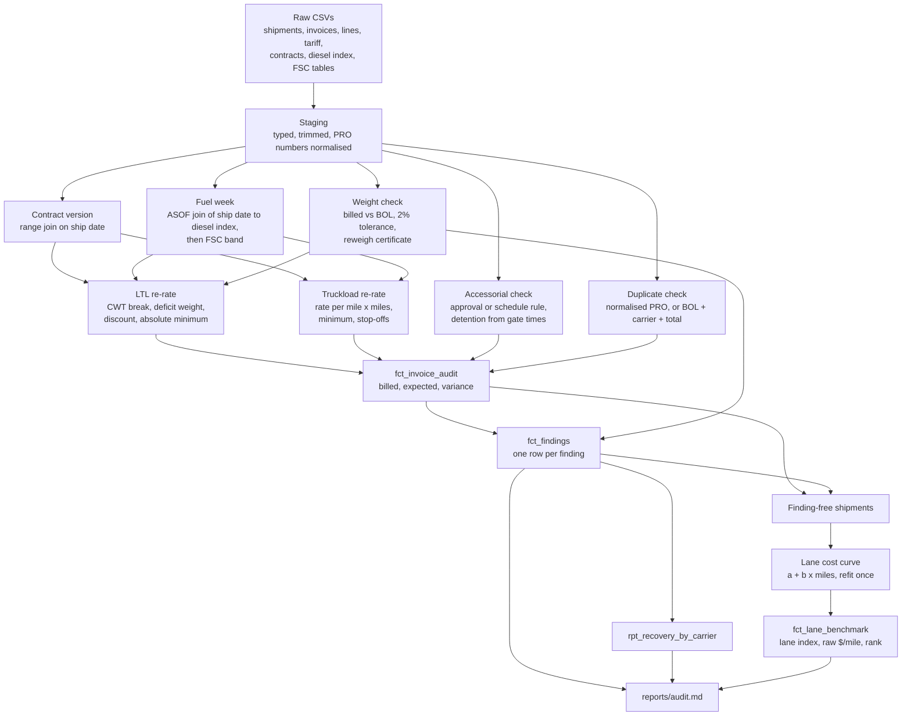

# rerate

[](https://github.com/SlateGitOrg/rerate/actions/workflows/ci.yml)


rerate audits freight invoices in DuckDB SQL. It re-rates every LTL and truckload bill from the contract version and the diesel-index week in force on the ship date, compares the result with what the carrier billed, and writes one finding per overcharge: fuel taken from the wrong week, duplicate invoices, accessorials nobody approved, billed weights above the BOL with no reweigh certificate, and rates that ignore a contract amendment. It also benchmarks truckload lanes against a fixed-plus-per-mile cost curve so that short hauls stop topping the "expensive lane" list. All audit and benchmark logic is in SQL files; Python only generates the synthetic data, runs the SQL, and formats the report. The data is synthetic and seeded, and the audit is scored against the error ledger the generator writes.

## The problem

A building-materials manufacturer ships roofing and insulation from three plants to distributors and job sites, and pays about 4,000 LTL and truckload invoices a year. Carriers take the fuel surcharge from the invoice week instead of the ship week, bill accessorials nobody approved, re-bill a shipment under a new invoice number, keep billing a rate after a contract amendment lowered it, and invoice reweighed weights without a certificate. Unaudited, a few percent of freight spend can leak this way; in the seeded example below the recovery is 0.67% of billed, because only 174 of 4,024 invoices carry an error and most of the dollars sit in 24 duplicates.

The transportation team also ranks lanes by cost per mile, which always blames short hauls for their fixed costs: an 80-mile move costs more per mile than a 1,200-mile one even when both are priced at market. Auditing needs the contract as the reference, and lane benchmarking needs a curve that has a fixed term.

## How it works



`sql/models.txt` lists the model files in order. The runner loads each raw CSV as a VARCHAR table named `raw_<name>`, then runs every listed file as `CREATE OR REPLACE TABLE <file stem> AS <select>` in a DuckDB file. The error ledger is never loaded, so the audit cannot peek at it.

| Layer | Models |
| --- | --- |
| `sql/staging/` | one typed, trimmed table per raw file, plus `stg_audit_params` (tolerances and thresholds in one row) |
| `sql/intermediate/` | `int_invoice_shipment`, `int_contract_version`, `int_fuel_week`, `int_weight_check`, `int_ltl_rated`, `int_tl_rated`, `int_accessorial_expected`, `int_duplicates` |
| `sql/marts/` | `fct_invoice_audit`, `fct_findings`, `rpt_recovery_by_carrier`, `fct_lane_benchmark` |
| `sql/tests/` | queries that return violating rows; the runner fails and prints them |

The data is synthetic: 5 carriers (3 LTL, 2 truckload), 3 plants and 60 consignees at made-up coordinates, with miles equal to the great-circle distance times 1.18. LTL tariff zones are set by miles (Z1 under 400, Z2 400 to under 1,000, Z3 1,000 and over). FSC tables use $0.05 bands covering `band_low <= index < band_high`; LTL rates are a percentage of discounted linehaul and truckload rates are dollars per mile. One truckload carrier's amendment lowers its rates 5% from 2026-01-01.

## Quick start

Python 3.11 or newer.

```bash
python -m venv .venv && . .venv/bin/activate
pip install -e ".[dev]"

rerate generate --seed 7 --out data/raw   # synthetic raw tables and the error ledger
rerate build                              # SQL models, then the data tests -> build/rerate.duckdb
rerate report                             # reports/audit.md
rerate export                             # marts as CSV in export/

pytest -q
ruff check . && ruff format --check .
```

Every command takes `--help`. `rerate build` exits non-zero and prints the violating rows if a data test fails.

## Example output

Seed 7: 4,000 shipments (2,400 LTL, 1,600 truckload on 30 lanes), 4,024 invoices, 9,835 invoice lines, 174 injected errors and 50 look-alikes that must not be flagged. Output of `rerate report`:

```text
4,024 invoices shipped 2025-07-01 to 2026-06-30, $4,439,870.01 billed. 174 findings on 174 invoices recover $29,904.27 (0.67% of billed).
```

Recovery by finding type:

| Finding type | Invoices | Overcharge ($) |
| --- | ---: | ---: |
| duplicate | 24 | 22,916.54 |
| unapproved_accessorial | 40 | 3,255.00 |
| contract_rate | 20 | 2,672.22 |
| weight_overbill | 30 | 774.21 |
| fsc_wrong_week | 60 | 286.30 |
| **total** | **174** | **29,904.27** |

Recovery by carrier:

| Carrier | Mode | Invoices | Billed ($) | Flagged | Recovery ($) | % of billed |
| --- | --- | ---: | ---: | ---: | ---: | ---: |
| TL1 | TL | 888 | 1,973,032.05 | 35 | 13,541.99 | 0.69 |
| TL2 | TL | 721 | 1,724,342.03 | 41 | 8,692.65 | 0.50 |
| LTL1 | LTL | 973 | 302,228.35 | 45 | 4,589.69 | 1.52 |
| LTL3 | LTL | 588 | 182,726.81 | 28 | 2,206.76 | 1.21 |
| LTL2 | LTL | 854 | 257,540.77 | 25 | 873.18 | 0.34 |

The findings equal the 174 ledger rows on (invoice, finding type), each overcharge equals its ledger amount to the cent, and none of the 50 look-alikes is flagged.

Truckload lanes: expected linehaul = $289.73 + $2.0543 x miles, refitted on 27 of 30 lanes after dropping the 3 whose first-pass index was above 1.15. The two short hauls (80 and 110 miles) lead the raw cost-per-mile ranking and are priced at market on the index; the three lanes contracted above the curve take the top of the index ranking and are the only ones flagged.

| Rank | By raw $/mile: lane | Miles | $/mile | Index | By lane index: lane | Miles | Index | $/mile |
| ---: | --- | ---: | ---: | ---: | --- | ---: | ---: | ---: |
| 1 | P1>C001 | 80 | 6.00 | 1.06 | P3>C003 | 640 | 1.22 | 3.06 |
| 2 | P2>C002 | 110 | 4.79 | 1.02 | P1>C004 | 900 | 1.21 | 2.87 |
| 3 | P3>C006 | 174 | 3.47 | 0.93 | P2>C005 | 1,250 | 1.20 | 2.73 |
| 4 | P2>C008 | 291 | 3.14 | 1.03 | P1>C001 | 80 | 1.06 | 6.00 |
| 5 | P1>C007 | 243 | 3.08 | 0.95 | P1>C016 | 700 | 1.06 | 2.61 |

Flagged lanes (index at or above 1.12, at least 8 finding-free shipments):

| Lane | Carrier | Miles | Shipments | Index |
| --- | --- | ---: | ---: | ---: |
| P3>C003 | TL1 | 640 | 52 | 1.22 |
| P1>C004 | TL1 | 900 | 46 | 1.21 |
| P2>C005 | TL1 | 1,250 | 96 | 1.20 |

The 80-mile lane is fourth on the index at 1.06, which is lane noise and fit error at the short end of the curve: inside the 0.93 to 1.07 band of ordinary lanes and well under the 1.12 flag line.

Each finding carries its evidence. One row per type from `fct_findings`:

| Type | Billed ($) | Expected ($) | Overcharge ($) | Evidence |
| --- | ---: | ---: | ---: | --- |
| contract_rate | 3,187.72 | 3,028.39 | 159.33 | linehaul billed 3187.72, contract in force on 2026-02-06 gives 3028.39 |
| duplicate | 468.57 | 0.00 | 468.57 | same PRO and BOL and a near-identical total as INV-000130, billed earlier |
| fsc_wrong_week | 87.80 | 85.81 | 1.99 | fuel billed 87.80, expected 85.81 at index 3.690 effective 2025-07-07 (ship date 2025-07-09, invoiced 2025-07-17) |
| unapproved_accessorial | 125.00 | 55.00 | 70.00 | RESIDENTIAL 70.00 billed with no approval or schedule rule covering it |
| weight_overbill | 302.83 | 291.61 | 11.22 | billed 2324 lb against 2238 lb on the BOL |

## Design decisions

**Expected comes from the ship date, never the invoice date.** The contract version is a range join on `effective_from`/`effective_to`, and the fuel week is an `ASOF JOIN` of the ship date to the Monday-effective diesel index. An invoice billed four weeks late with the right fuel week is therefore clean, while one billed a week late with the invoice week's rate is a finding. The cost is that the audit is only as good as the ship dates and a complete index history; a missing index week shows up as a failed data test rather than a silent zero.

**One finding per cause, with the cents reconciled.** Linehaul variance goes to the weight finding when the billed weight is over tolerance and to the contract-rate finding otherwise. LTL fuel is a percentage of linehaul, so the fuel that follows a linehaul error travels with it, and only the remaining fuel variance is a fuel-week finding. What the split leaves over is bounded: up to the $0.05 tolerance it is rounding and is added to the largest finding; a larger positive remainder becomes an explicit `unexplained_variance` finding; a larger negative one (under-billing) is left alone and fails a data test. Two data tests then hold the model to account: a flagged invoice's overcharges sum to billed minus expected, and an unflagged invoice is within the tolerance of the contract. The trade-off is that on an invoice with two overlapping errors the split between findings is a convention, not a measurement; the total is exact either way.

**A duplicate takes the whole invoice.** An invoice is a duplicate when an earlier-billed invoice from the same carrier, under a different invoice number, has the same normalised PRO or the same BOL with a total within $1. Its expected total is zero and every other finding on it is suppressed, so a re-billed invoice is not counted twice. The earliest-billed invoice is the original and is never flagged. The $1 window catches re-bills with a mistyped PRO and a slightly different fuel line, but it would also flag a legitimate re-bill after a corrected invoice that lands within a dollar; PROs are compared per carrier because different carriers reuse number ranges.

**The lane curve has a fixed term and is fitted on clean shipments.** Expected truckload linehaul is `a + b x miles` from `regr_intercept`/`regr_slope` over one point per lane (the median linehaul of finding-free shipments), so a finding such as a stale rate cannot drag a lane's own benchmark. Lanes whose first-pass index is above 1.15 are dropped and the line is refitted once, because overpriced lanes otherwise pull the curve toward themselves and hide. One refit is a deliberate stop: it is easy to explain and does not chase noise, but a very large share of overpriced lanes would need a robust fit instead.

**Plain SQL files and a runner with no templating.** Models are single SELECTs named after their file; raw data is loaded as text and typed in staging; thresholds sit in the one-row `stg_audit_params` model instead of being repeated as literals. The cost is that nothing in SQL can be parameterised per run, so a different tolerance is a one-line edit to that file. Evaluation is single-threaded so two builds produce identical marts.

**The generator carries its own decimal rating engine.** Carrier bills and the ledger are produced by a Python `Decimal` implementation of the contract arithmetic, and the SQL re-implements it independently. Agreement to the cent across 174 errors is therefore a real check rather than shared code, at the price of keeping two implementations in step; the hand-worked fixtures in the tests pin both.

## Testing

```bash
pytest -q
```

81 tests, all offline and warning-free:

- **Hand-built worlds** (`tests/test_models.py`): the 900 lb class 70 shipment rates at the 1,000 lb break ($317.50 gross, $107.95 net after a 66% discount) and a 120 lb shipment returns the $95.00 minimum; an ASOF fixture gives $23.75 fuel for a shipment on 2026-03-10 and $22.67 for one on 2026-03-08, whatever the invoice date; a truckload shipment on 2025-12-31 uses contract v1 and one on 2026-01-02 uses v2 (5% lower), and an overlapping v3 fails the uniqueness test and prints the shipment id; PROs `0012345-6` and `123456` meet on one key; detention is priced per started hour after two free hours; cent rounding is ignored and a $0.06 overcharge is not; a leftover under the tolerance joins the largest finding, a larger one becomes an `unexplained_variance` finding, and under-billing that no finding explains fails the data tests.
- **Lane benchmark** (`tests/test_lane_benchmark.py`): lanes on an exact line recover the intercept and slope, an overpriced lane is dropped from the refit and scores 1.3, and lanes with fewer than 8 finding-free shipments are not scored.
- **Seed 7 against the ledger** (`tests/test_acceptance.py`): findings match the 174 ledger rows on (invoice, type) and on amount; the 50 look-alikes (25 reweighs with a certificate, 15 approved detentions, 10 invoices billed 2 to 4 weeks late with the correct fuel week) produce no findings; totals and each finding type's total match the ledger within $0.01; all 24 duplicates are flagged for their full amount and no original is; exactly the 3 overpriced lanes are flagged at an index of 1.15 to 1.25; both short hauls rank in the top 5 by raw cost per mile with an index of 0.93 to 1.07; all SQL tests return zero rows; two builds give identical marts.
- **Generator** (`tests/test_generator.py`): two seed-7 runs are byte-identical; miles are great-circle times 1.18; the ledger mix is 60/24/40/30/20; weight errors are 3 to 15% over with no certificate.
- **Reference arithmetic** (`tests/test_rating.py`) and the runner and CLI (`tests/test_runner_cli.py`).

## Project layout

```text
sql/
  models.txt                 model order
  staging/                   typed raw tables and stg_audit_params
  intermediate/              contract version, fuel week, rating, accessorials, weights, duplicates
  marts/                     fct_invoice_audit, fct_findings, rpt_recovery_by_carrier, fct_lane_benchmark
  tests/                     data tests: each returns violating rows
src/rerate/
  cli.py                     generate, build, report, export
  runner.py                  loads raw CSVs, runs models and data tests
  report.py                  Markdown report and CSV export from the marts
  generator/                 seeded data: reference tables, shipments, billing and error injection, rating
tests/                       fixtures, lane benchmark, acceptance, generator, runner
reports/audit.md             report from the seed 7 run
```

## License

MIT. See `LICENSE`.
